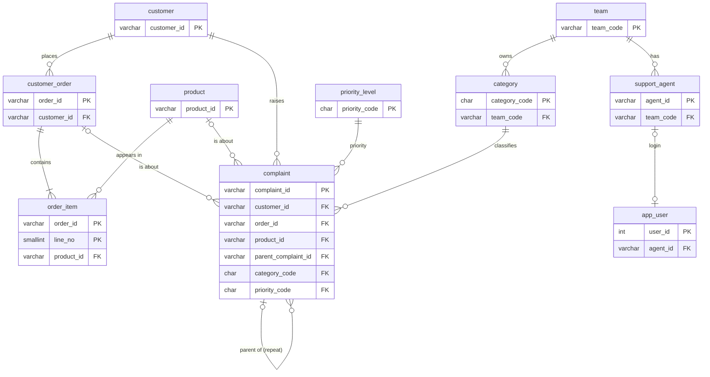
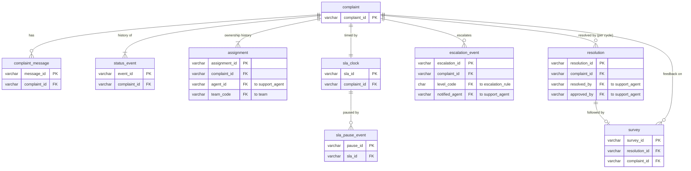
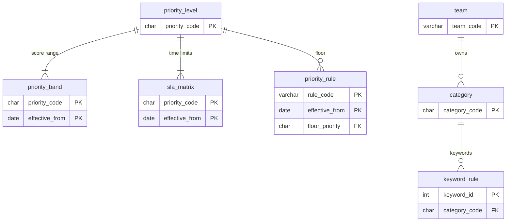

# ER Diagram and Relationships

The diagrams below render on GitHub. PNG copies are in `docs/diagrams/` for slides. Field-level detail is in `DATA_DICTIONARY.md`. The SQL is in `backend/src/main/resources/db/migration/`.

Notation: `||` exactly one, `o|` zero or one, `|{` one or more, `o{` zero or more.

## 1. Core data model

Customers, orders, products and complaints, with the teams and priority levels they depend on.

## 2. Complaint history, SLA and resolution

Everything that happens to a complaint is stored as append-only rows. Nothing here is overwritten.

## 3. Rule tables

Rules live in tables with effective dates, so they can change without code changes and old scores stay reproducible.

## 4. Cardinality, optionality and lifecycle

| Relationship                                           | Cardinality      | Optional?                     | Notes                                                                                             |
| ------------------------------------------------------ | ---------------- | ----------------------------- | ------------------------------------------------------------------------------------------------- |
| Customer to Order                                      | 1:N              | A customer may have no orders |                                                                                                   |
| Order to Product                                       | **N:M**          |                               | Resolved with the bridge table `order_item` (PK order_id + line_no, unique order_id + product_id) |
| Customer to Complaint                                  | 1:N              | Required                      | A complaint without a customer is an injected anomaly that the validator must catch               |
| Order to Complaint                                     | 1:N              | **Optional**                  | A missing-order or enquiry complaint may have no valid order                                      |
| Product to Complaint                                   | 1:N              | **Optional**                  |                                                                                                   |
| Complaint to Complaint (parent)                        | 1:N              | **Optional**                  | Links a repeat complaint to the original                                                          |
| Category to Complaint                                  | 1:N              | Required                      |                                                                                                   |
| Priority level to Complaint                            | 1:N              | Required                      | Final priority after score band and floors                                                        |
| Team to Category, Team to Agent                        | 1:N              | Required                      |                                                                                                   |
| Agent to AppUser                                       | 1:0..1           | Optional                      | A requester or analyst login may have no agent record                                             |
| Complaint to Message                                   | 1:N              |                               | Append-only                                                                                       |
| Complaint to StatusEvent                               | 1:N (at least 1) |                               | Append-only. complaint.status mirrors the latest event                                            |
| Complaint to Assignment                                | 1:N (at least 1) |                               | Ownership history. At most one open row (ended_at is null)                                        |
| Complaint to SLAClock                                  | 1:1              |                               | One clock per complaint                                                                           |
| SLAClock to SLAPauseEvent                              | 1:N              |                               | A pause is valid only while AWAITING_CUSTOMER                                                     |
| Complaint to EscalationEvent                           | 1:N              |                               | Unique per complaint, cycle and level                                                             |
| Complaint to Resolution                                | 1:N              |                               | One per cycle. A reopen adds a new resolution and keeps the old one                               |
| Resolution to Survey                                   | 1:0..1           | **Optional**                  | Created only after the complaint is closed                                                        |
| PriorityLevel to PriorityBand, SLAMatrix, PriorityRule | 1:N              |                               | Effective dated                                                                                   |
| Category to KeywordRule                                | 1:N              | Only for type CATEGORY        |                                                                                                   |

### Effective dates

`priority_band`, `sla_matrix` and `priority_rule` carry `effective_from` and `effective_to`. To change a value, close the current row with `effective_to` and add a new row. Each complaint stores `rule_version`, so its priority can be recomputed with the rules that applied at the time.

### Lifecycle states

Complaint status: `NEW`, `CLASSIFIED`, `ASSIGNED`, `IN_PROGRESS`, `AWAITING_CUSTOMER`, `RESOLVED`, `CLOSED`, `REOPENED`. Allowed transitions are in `RULES_AND_ASSUMPTIONS.md` section 8.

SLA clock state: `RUNNING`, `PAUSED`, `STOPPED`.

### What the database enforces and what the validator checks

| Enforced by the database                      | Checked by the validator (so injected anomalies can be detected and measured) |
| --------------------------------------------- | ----------------------------------------------------------------------------- |
| Primary keys and ID formats                   | Foreign key problems in the exported files (for example a missing customer)   |
| Foreign keys                                  | Resolution before complaint, survey before closure (date ordering)            |
| Enumerations and value ranges                 | SLA pause while not AWAITING_CUSTOMER                                         |
| order_item.line_total = quantity x unit_price | Order total equals the sum of its items                                       |
| One SLA clock per complaint, unique sequences | Repeat issue not linked, safety issue in a low priority                       |
|                                               | Priority and SLA recomputed from the rules, floors honoured                   |
|                                               | Allowed lifecycle transitions, status mirrors the latest event                |

The split is deliberate: if the database rejected an anomalous row, the validator would never see it and could not be scored against `ground_truth.csv`.

> **Load note:** a row that breaks a foreign key (the complaint-without-customer anomaly) cannot be inserted into the database. The generator exports it in the CSV and JSON files, the validator reports it from the files, and the database loader skips it and records the reason in `data_quality_issue`.
